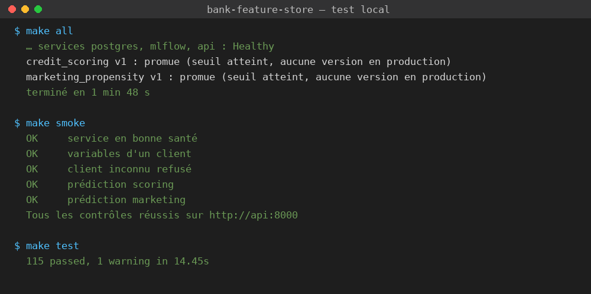
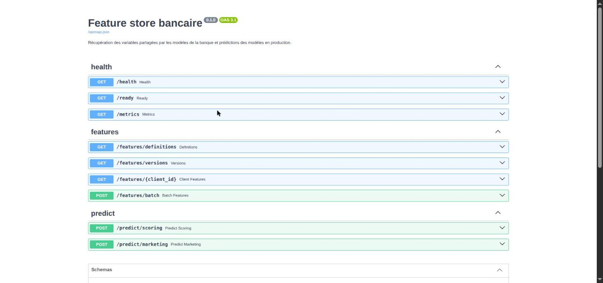
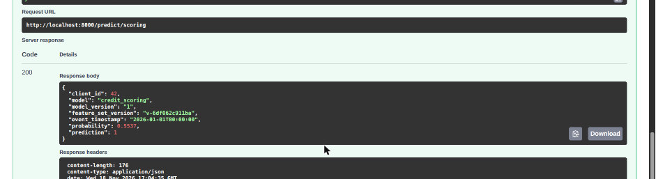
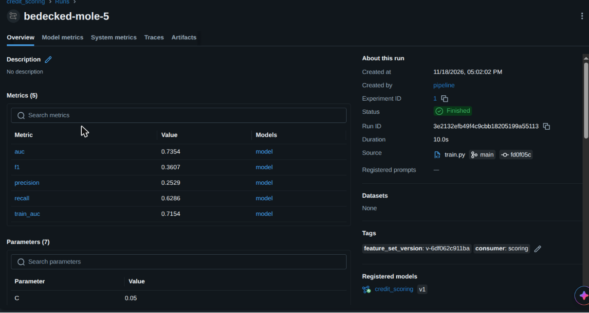
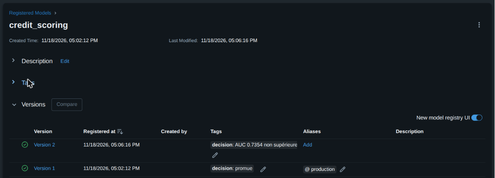
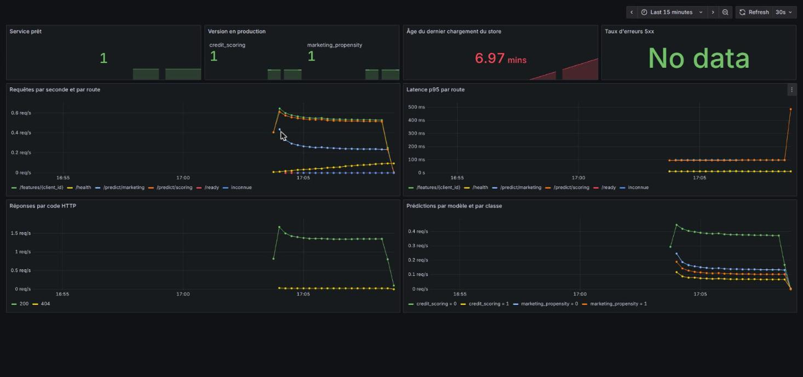
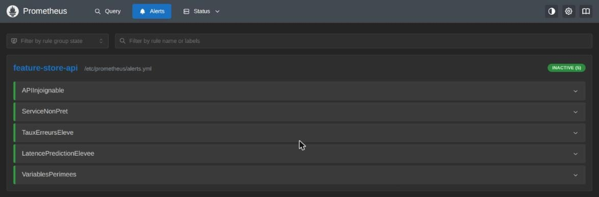
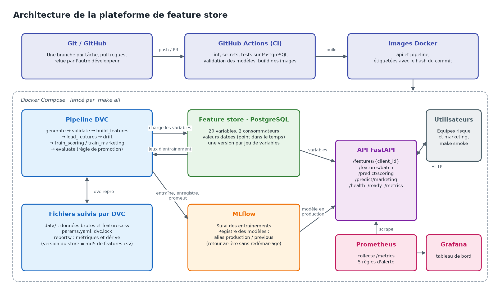

# Plateforme de feature store pour l'analyse prédictive bancaire

[](https://github.com/Devops-Projet/Analyse-pr-dictive-avec-feature-store/actions/workflows/ci.yml)

Magasin centralisé de variables de machine learning, partagé par plusieurs modèles
(scoring crédit et propension marketing), pour éviter de les recalculer dans chaque projet.

**Outils :** Git/GitHub, DVC, MLflow, Docker, FastAPI, PostgreSQL, pandas, scikit-learn.

## État du projet

Fonctionnel de bout en bout : données versionnées avec DVC, feature store PostgreSQL et son API
de récupération, deux modèles consommateurs suivis dans MLflow, routes de prédiction, CI et
supervision. Une seule commande reconstruit l'ensemble sur une machine neuve.

| Résultat | Valeur |
|---|---|
| Variables dans le store | 20, sur 4 instantanés (01/10/2025 au 01/01/2026) |
| AUC en test, scoring crédit | 0,735 (plafond théorique des données : 0,782) |
| AUC en test, propension marketing | 0,646 (plafond théorique des données : 0,790) |
| Indicateurs DORA | [docs/dora.md](docs/dora.md) |

## Aperçu

Captures prises le 18/11/2026 sur une machine vidée (`docker compose down -v`), après
`make all` et `make monitoring`.

**Test local :** reconstruction complète en 1 min 48 s, contrôle après déploiement et tests.



**API :** documentation OpenAPI et prédiction du scoring pour le client 42.





**MLflow :** exécution d'entraînement (métriques, paramètres, version du feature set) et règle
de promotion : la version 2, d'AUC identique, n'a pas remplacé la version 1 en production.





**Supervision :** tableau de bord Grafana et règles d'alerte Prometheus.





## Architecture



Composants, flux et choix techniques : [docs/architecture.md](docs/architecture.md).

## Démarrage

Prérequis : Docker avec Docker Compose, et `make`.

```bash
make all
```

Cette commande crée `.env` à partir de `.env.example`, démarre les services, attend qu'ils
soient prêts, puis lance le pipeline avec `dvc repro`.

| Commande | Rôle |
|---|---|
| `make up` / `make down` | Démarrer ou arrêter les services |
| `make pipeline` | Relancer le pipeline DVC |
| `make test` / `make lint` | Lancer les tests ou le lint |
| `make audit` | Rechercher un secret dans les fichiers suivis par Git |
| `make smoke` | Contrôler le service démarré |
| `make monitoring` | Démarrer Prometheus et Grafana |
| `make dora` | Mesurer les indicateurs DORA sur `main` |
| `make lock` | Régénérer `requirements.lock` |

| Service | Adresse |
|---|---|
| API | http://localhost:8000/health |
| MLflow | http://localhost:5000 |

## Variables d'environnement

`make setup` (appelé par toutes les commandes) crée `.env` à partir de `.env.example` et y
ajoute les variables manquantes. `.env` n'est jamais commité. Le service refuse de démarrer si
une variable obligatoire manque.

| Variable | Rôle | Valeur par défaut |
|---|---|---|
| `POSTGRES_HOST`, `POSTGRES_PORT` | Adresse de PostgreSQL | `postgres`, `5432` |
| `POSTGRES_DB`, `POSTGRES_USER` | Base et utilisateur du feature store | `feature_store` |
| `POSTGRES_PASSWORD` | Mot de passe PostgreSQL (à changer) | `changeme` |
| `MLFLOW_TRACKING_URI`, `MLFLOW_PORT` | Adresse et port de MLflow | `http://mlflow:5000`, `5000` |
| `API_PORT` | Port de l'API sur la machine | `8000` |
| `PROMETHEUS_PORT`, `GRAFANA_PORT` | Ports de la supervision | `9090`, `3000` |
| `GRAFANA_ADMIN_PASSWORD` | Mot de passe du compte `admin` de Grafana (à changer) | `changeme` |

## API de récupération

Documentation interactive : http://localhost:8000/docs

| Route | Rôle |
|---|---|
| `GET /features/{client_id}` | Dernières variables d'un client |
| `POST /features/batch` | Variables de 1 à 1 000 clients |
| `GET /features/definitions` | Catalogue des variables |
| `GET /features/versions` | Versions chargées du store |
| `GET /health` | État du service |

Paramètres optionnels : `version` (la plus récente par défaut), `as_of` (lecture au point dans
le temps) et `features` (sous-ensemble de variables).

```bash
curl "http://localhost:8000/features/42?features=age&features=revenu_mensuel"
# {"client_id":42,"event_timestamp":"2026-01-01T00:00:00",
#  "features":{"age":64.0,"revenu_mensuel":2412.88},"version":"v-6df062c911ba"}

curl -X POST http://localhost:8000/features/batch \
  -H "content-type: application/json" -d '{"client_ids": [1, 5000], "features": ["age"]}'
# {"version":"v-6df062c911ba",
#  "results":[{"client_id":1,"event_timestamp":"2026-01-01T00:00:00","features":{"age":26.0}}],
#  "missing":[5000]}
```

Codes d'erreur : `404` pour un client ou une version inconnus, `400` pour une variable
inconnue, `422` pour une requête invalide.

## Prédiction

| Route | Rôle |
|---|---|
| `POST /predict/scoring` | Probabilité de défaut d'un client |
| `POST /predict/marketing` | Probabilité de souscription d'un client |

L'API lit les variables du client dans la version du store sur laquelle le modèle a été
entraîné, puis applique le modèle en production du registre MLflow.

```bash
curl -X POST http://localhost:8000/predict/scoring \
  -H "content-type: application/json" -d '{"client_id": 42}'
# {"client_id":42,"model":"credit_scoring","model_version":"1",
#  "feature_set_version":"v-6df062c911ba","event_timestamp":"2026-01-01T00:00:00",
#  "probability":0.5537,"prediction":1}
```

Codes d'erreur : `404` pour un client inconnu, `503` si aucun modèle n'est en production.

Après chaque déploiement, `make smoke` vérifie le parcours réel. Le retour arrière et la
conduite à tenir en cas d'incident sont décrits dans [docs/runbook.md](docs/runbook.md).

## Pipeline

`dvc repro` enchaîne `generate → validate → build_features → load_features → drift →
train_scoring → train_marketing → evaluate`. `load_features` charge les variables dans PostgreSQL et est
relancée à chaque exécution, car DVC ne suit pas le contenu de la base. Si le registre MLflow a
été vidé, `make pipeline` réentraîne les modèles automatiquement.

## Modèles

Deux modèles lisent leurs variables dans le store et sont suivis dans MLflow
(http://localhost:5000) : `credit_scoring` et `marketing_propensity`. Un modèle n'est mis en
production que si son AUC dépasse un seuil minimal et celle de la version en production.

| Commande | Rôle |
|---|---|
| `make models` | Versions en production et précédentes |
| `make rollback MODEL=credit_scoring` | Remettre la version précédente en production |

Voir [docs/modeles.md](docs/modeles.md) pour les modèles essayés et les résultats.

## Supervision

| Route | Rôle |
|---|---|
| `GET /health` | Le processus répond (healthcheck Docker) |
| `GET /ready` | Store chargé et modèles en production ; `503` sinon |
| `GET /metrics` | Métriques Prometheus : trafic, erreurs, latence, prédictions, fraîcheur |

`make monitoring` démarre Prometheus (http://localhost:9090), avec 5 règles d'alerte, et
Grafana (http://localhost:3000), avec un tableau de bord prêt à l'emploi. L'étape DVC `drift`
mesure la dérive des variables dans `reports/drift.json`. Seuils, responsables et actions :
[docs/runbook.md](docs/runbook.md#supervision).

## Intégration continue

GitHub Actions ([.github/workflows/ci.yml](.github/workflows/ci.yml)) s'exécute à chaque
pull request et à chaque push sur `main` :

1. **Lint et secrets :** ruff, black et detect-secrets ;
2. **Tests :** tests unitaires et d'intégration sur un PostgreSQL de service, avec couverture ;
3. **Validation des modèles :** seuil d'AUC, probabilités entre 0 et 1, valeurs manquantes ;
4. **Build :** images de l'API et du pipeline, étiquetées avec le hash du commit.

Un contrôle en échec bloque les étapes suivantes. En local, les images portent aussi le hash du
commit (`IMAGE_TAG`), ce qui permet d'identifier la version déployée.

## Données

Le pipeline écrit dans `data/`, qui est ignoré par Git et suivi par DVC. Les données brutes, le
rapport de validation et `features.csv` sont stockés sur le remote DVC
[dagshub.com/hichamouaouche/bank-feature-store](https://dagshub.com/hichamouaouche/bank-feature-store).

DagsHub demande un identifiant, même pour lire. Chaque utilisateur crée un compte gratuit, puis
un jeton (*User Settings → Tokens*), et l'enregistre une fois dans `.dvc/config.local`, qui
n'est jamais commité :

```bash
docker compose run --rm --no-deps pipeline sh -c "\
  dvc remote modify origin --local auth basic && \
  dvc remote modify origin --local user <utilisateur-dagshub> && \
  dvc remote modify origin --local password <jeton-dagshub>"
```

```bash
make data-pull   # récupérer les données de la version de dvc.lock
make data-push   # envoyer une nouvelle version (droit d'écriture sur le dépôt DagsHub)
```

Sans accès au remote, `make all` régénère les mêmes données grâce à la seed de `params.yaml` :
le fichier `features.csv` obtenu a la même empreinte que celle de `dvc.lock`.

## Limites connues

- Données synthétiques : les performances des modèles ne préjugent pas d'un cas réel
  (voir le plafond théorique dans [docs/modeles.md](docs/modeles.md)).
- `revenu_mensuel`, `nb_produits_detenus` et `utilise_app_mobile` n'ont pas d'historique : même
  valeur à chaque instantané.
- Calcul par lots mensuels ; pas de store en ligne à faible latence (Redis) ni d'orchestrateur.
- Les alertes sont visibles dans Prometheus mais ne sont envoyées ni par e-mail ni par messagerie.
- Déploiement local avec Docker Compose, sur une seule machine.
- Le remote DVC demande un jeton DagsHub, même en lecture ; sans lui, les données sont
  régénérées à l'identique.

## Documentation

- [Cadrage](docs/cadrage.md)
- [Architecture](docs/architecture.md)
- [User stories et définition de « terminé »](docs/user_stories.md)
- [Variables partagées](docs/variables.md)
- [Catalogue des variables](docs/feature_catalog.md)
- [Modèles](docs/modeles.md)
- [Procédures d'exploitation](docs/runbook.md)
- [Indicateurs DORA](docs/dora.md)
- [Conventions de contribution](CONTRIBUTING.md)
