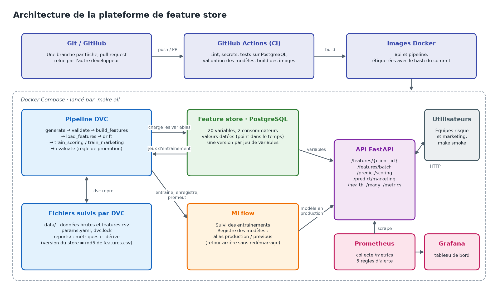

# Architecture



Le schéma est produit par [scripts/draw_architecture.py](../scripts/draw_architecture.py) :

```bash
docker compose run --rm --no-deps pipeline python scripts/draw_architecture.py
```

## Composants

| Composant | Rôle | Technologie |
|---|---|---|
| Pipeline | Génère et valide les données, calcule les variables, les charge dans le store, entraîne et évalue les modèles, mesure la dérive | DVC, pandas, scikit-learn |
| Feature store | Stocke les valeurs de chaque variable par client et par date, avec une version par jeu de variables | PostgreSQL 16 |
| Suivi et registre des modèles | Garde les paramètres, métriques et artefacts de chaque entraînement ; l'alias `production` désigne la version servie | MLflow |
| API | Sert les variables (lecture en ligne ou au point dans le temps) et les prédictions des deux modèles | FastAPI, Pydantic |
| Supervision | Collecte les métriques de l'API, évalue les règles d'alerte, affiche le tableau de bord | Prometheus, Grafana |
| Livraison | Lint, recherche de secrets, tests, validation des modèles et build des images à chaque pull request | GitHub Actions |

Tous les services d'exécution tournent dans Docker Compose et démarrent avec `make all`.

## Flux principaux

1. **Calcul des variables.** `dvc repro` lit les tables sources, calcule les 20 variables à
   plusieurs dates (instantanés), écrit `data/features/features.csv`, puis les charge dans
   PostgreSQL. La version du jeu est dérivée du hash md5 du fichier : un même calcul donne
   toujours la même version.
2. **Entraînement.** Chaque modèle lit dans le store les variables qui lui sont destinées, à la
   date du label, ce qui évite toute fuite d'information future. L'entraînement est enregistré
   dans MLflow avec la version du store utilisée.
3. **Promotion.** L'étape `evaluate` ne met une version en production que si son AUC dépasse le
   seuil de `params.yaml` et celle de la version en production. L'ancienne version devient
   `previous`.
4. **Prédiction.** L'API résout l'alias `production` à chaque requête, lit les variables du
   client dans la version du store du modèle, puis renvoie la probabilité et la classe. Un
   retour arrière est donc pris en compte sans redémarrer l'API.
5. **Supervision.** Prometheus interroge `/metrics` toutes les 15 secondes ; Grafana affiche
   trafic, erreurs, latence, prédictions et fraîcheur du store. L'étape DVC `drift` compare
   les distributions de deux instantanés.

## Choix d'architecture

| Choix | Raison | Alternative écartée |
|---|---|---|
| Store en format long (une ligne par client, variable et date) dans PostgreSQL | Ajouter une variable ne change pas le schéma ; la lecture au point dans le temps est une simple requête | Une table large par version, à migrer à chaque nouvelle variable |
| Version du store = hash du fichier de variables | Lien direct entre DVC, le store et les modèles | Numéro de version saisi à la main |
| Alias MLflow `production` / `previous` | Retour arrière en une commande, sans redéploiement | Modèle copié dans l'image de l'API |
| Une seule commande (`make all`) | Reproductible sur une machine neuve, sans étape manuelle | Procédure d'installation à suivre à la main |
| Données synthétiques à seed fixe | Pas de données bancaires réelles ; mêmes données à chaque exécution | Jeu public non adapté aux deux usages |
